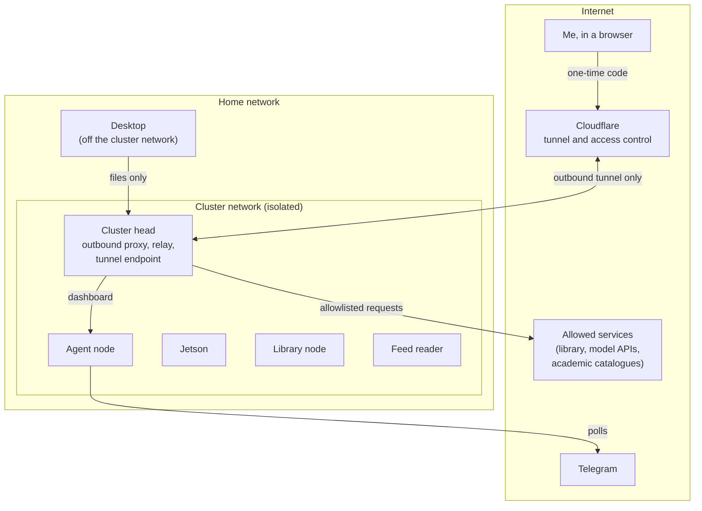

# Architecture

*As of October 2026. This page describes the design, not every detail.*

## A closed universe

The Mechanism is designed as a closed universe. The aim was a closed, personal research tool, not
an experiment in an open world of agents roaming the internet. What enters it is chosen: my
library, the feeds I follow, a handful of structured academic catalogues, and my own messages.
Nothing arrives because an agent went looking for it.

That closure is a research choice as much as a security one. It balances the power of agentic AI
with a degree of epistemic control and definition that the open internet can't offer. I know what the system can know, where each
piece of it came from, and every passage it retrieves carries its source. When it answers a
question, the boundaries of what it drew on are the boundaries I set.

Inside that universe, data moves on a *rivers of data* model. The cluster head is the primary
headwaters: the point where scheduled work starts, where files are relayed between machines, and
through which everything entering or leaving passes. From there data flows down defined channels to
the machines and agents that use it. Each agent is constrained to the data relevant to its function,
and reaches nothing else. Most of what follows on this page is how those channels are cut and kept
narrow.

## The stance

The Mechanism is a research cluster under one researcher's control, on home hardware. Every external
account it uses is a throwaway, created for the purpose, so a compromise means rotating a key and
restoring from backup, not a disaster. That framing is deliberate. It is why the security here
looks pragmatic rather than fortified.

**What it defends against:**

- **A rogue agent.** The main concern is an AI agent that reads hostile text, is manipulated by it,
  and then tries to damage data, reach credentials it shouldn't have, or send data out.
- **Credential leaks** from a machine's filesystem.
- **Malformed input** that crashes a service.
- **My own mistakes.** The answer to these is backups and rollback, not prevention.

**What it doesn't try to defend against:** a determined state-level adversary, physical access to the
machines, compromised upstream software, very slow covert exfiltration, or the compromise of
Cloudflare, which sits in front of it.

## The network

- **An isolated network.** The cluster sits on its own VLAN, separated from the rest of the home
  network by rules on the router. The desktop, which does the heavy processing, is kept outside it
  and reaches the cluster only by depositing files.
- **No open ports.** Nothing on the cluster accepts connections from the internet. Remote access to
  the web interfaces runs through a tunnel that the cluster opens outwards, behind an access check
  that sends a one-time code.
- **Every machine denies by default, in both directions.** Inside the cluster network, traffic
  between machines is governed by each machine's own firewall, which allows only the specific
  connections that machine needs.
- **One way out.** No machine reaches the internet directly. Outbound web requests go through a
  filtering proxy on the cluster head, and each machine has its own short list of permitted
  destinations. Anything else is refused and logged.

## Credentials and bridges

Each credential lives on one machine, and the rest of the cluster reaches the service it unlocks
through a small bridge that exposes only the operations needed.

| Credential | Lives on | Everyone else gets |
|---|---|---|
| Reference library key | Library node | A bridge with a fixed set of read and write routes |
| Feed reader key | Feed reader | A bridge for managing subscriptions and reading entries |
| Model and messaging keys | The agent node, in a file only the agent's user can read, and the workflow engine on the cluster head, for the weekly digest and notifications | Nothing: no other machine needs them |
| Infrastructure secrets | Encrypted in the configuration repository | Decrypted only when the configuration is applied |

The desktop holds its own library key, for fetching PDFs. It sits off the cluster network, so a
compromised cluster machine can't reach it.

## The agent

The agent is [Hermes Agent](https://github.com/NousResearch/hermes-agent), an open-source framework
from Nous Research, running Claude Opus 5.5 through OpenRouter. I work with it mostly in its browser
dashboard and sometimes over Telegram. It is the part of the system most exposed to what it reads,
so it gets the least:

- **Its own machine and its own user,** with no SSH key. The cluster head refuses SSH connections
  from it in any case.
- **Four routes into the cluster,** each to a narrow service: the read-only corpus API, the library
  bridge, the feed bridge, and a bridge for writing notes. It can't reach the models or the vector
  store behind the corpus API.
- **A closed set of inputs.** It doesn't fetch arbitrary web pages. What reaches it is my own
  messages, structured results from a handful of academic catalogues, passages from the corpus, and
  entries from the feeds I follow. The weekly digest goes a step further: feed items are first
  scored by a small local model that can return only a structured verdict and has no tools.
- **Operating-system confinement.** An AppArmor profile limits what the agent's process can touch.

The remaining risk is stated rather than hidden: instructions planted in a document I ingest could
reach the agent inside a retrieved passage. The defences above limit what such an instruction could
then do.

## Models

| Model | Runs on | Used for |
|---|---|---|
| Qwen3 8B | Jetson | Triage: scoring feed items for relevance to each research track |
| Qwen3 32B | Desktop GPU | Describing each passage of every ingested text; triaging new publication records |
| nomic-embed-text | Jetson | Turning passages and questions into vectors for search |
| Claude Opus 5.5, through OpenRouter | Anthropic's cloud | The agent: conversation, and answering questions from retrieved passages |
| Claude Sonnet 5, through OpenRouter | Anthropic's cloud | Curating the weekly digest from the items Qwen3 8B has scored |

## Software and operations

- **Infrastructure as code.** Every cluster machine is configured from one repository with Ansible.
  Services run in Docker containers or as systemd units, and the desktop's jobs run from the same
  repository under cron.
- **The main components** are all open source: Hermes Agent (the agent), Chroma (vector store),
  Ollama (local models), Syncthing (file transport), n8n (scheduled workflows), Miniflux (feeds),
  PyMuPDF (text extraction), and Prometheus and Grafana (monitoring). Zotero holds the reference
  library, and Cloudflare provides the tunnel and access control.
- **Backups** run daily to local storage and weekly, encrypted, to cloud object storage. Rollback is
  treated as a normal operation, not an emergency.
- **Integrity reporting.** An hourly check compares what the library says the corpus should contain
  with what the vector store holds, and reports any drift.
