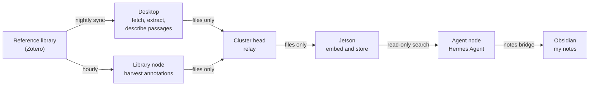
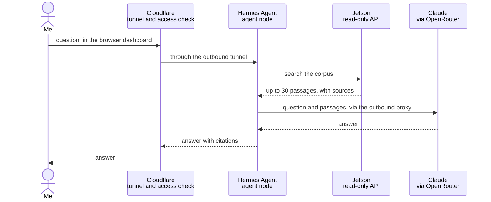

# How TM works

*As of October 2026. The Mechanism (TM) is evolving; this page describes its design rather than every detail. The full code is kept in a private repository.*

The easiest way to understand TM is to follow two things through it: a book on its way
into the corpus, and a question on its way to an answer. Most of the design shows up along the
way, including where the boundaries sit and why.

## The machines

| Machine | Role |
|---|---|
| **Desktop** (GPU workstation) | The heavy lifting: fetching PDFs, extracting text, and running Qwen3 32B to describe each passage. Kept off the cluster network by design. |
| **Cluster head** (Raspberry Pi 5) | Coordination: scheduled workflows, monitoring, backups, the web front door, the relay that carries files between machines, and the proxy every outbound request must pass through. |
| **Agent node** (Raspberry Pi 5) | The research agent I talk to: [Hermes Agent](https://github.com/NousResearch/hermes-agent), an open-source agent framework from Nous Research. It runs on its own machine, as its own user, and holds no keys to the rest of the cluster. |
| **Jetson** (NVIDIA Orin Nano) | The corpus itself: the Chroma vector store, the nomic-embed-text embedding model, Qwen3 8B for triage, all served locally through Ollama, and a read-only API in front of them. |
| **Library node** (Raspberry Pi 4) | The only machine in the cluster holding the reference library's key. It harvests annotations and serves a narrow bridge for library writes. |
| **Other Raspberry Pi 4s** | A feed reader, a social media monitor, and three spares kept powered off. |

## A book's journey

1. **I file the book.** In the reference library I add a record with its PDF to the `vault`
   collection of a research track. A track is any top-level collection that has a `vault` child,
   so the library's own structure is the system's vocabulary. A new track needs no code change.
2. **The desktop fetches it.** Every night at 02:00 a sync on the desktop reads the library and
   fetches new PDFs into a local cache. If the library contradicts itself, for instance when an
   item has been trashed but its PDF hasn't, the sync refuses to publish that track's changes
   rather than guess. It reports the problem and leaves everything as it was.
3. **The text is extracted and checked.** Every six hours the desktop extracts the text. Scanned
   PDFs with no text layer, and texts too thin to be the whole work (a book yielding fewer than 40
   passages, for example), are set aside with a reason, not quietly ingested.
4. **Each passage is described.** The text is cut into overlapping passages of about 3,000
   characters. For each one, Qwen3 32B, running on the desktop's GPU, writes a one-sentence
   description of what the passage is about, which makes it much easier to find later. None of
   this leaves my hardware.
5. **Files travel, commands don't.** The results are written as plain files, and Syncthing
   carries them through the cluster head to the Jetson. The channel moves
   files only, so nothing on the desktop can instruct anything in the cluster.
6. **The Jetson stores it.** Within a minute the Jetson notices the new file, embeds each passage
   with nomic-embed-text, and stores it in that track's Chroma collection with its bibliographic
   details.
7. **Annotations follow separately.** Every hour the library node harvests my highlights and notes
   from the library and sends them the same way, into a collection of their own.
8. **The work continues in Obsidian.** Once a book is in the corpus the agent can search it, and
   what comes of that lands in my Obsidian notes: plain Markdown files holding lab notes, transcripts
   of discussion sessions, and drafts. The agent reaches them through a narrow bridge on the cluster
   head, and Syncthing keeps a copy on my computers, iPad and iPhone. The relationship runs one way.
   Notes draw on the corpus but are never ingested into it, so a corpus search returns my sources and
   my annotations on them, not my own earlier prose.

Removal is deliberately slower than addition. A work that is unfiled or deleted is removed only after
two observations agree and a grace period has passed, and the nightly cleanup is capped. A mistake
in the library can be undone before the corpus loses anything.

## A question's journey

1. **I ask.** Usually in the agent's browser dashboard. Cloudflare checks it's me with a one-time
   code, then passes the request down a tunnel the cluster itself opened, so nothing on the cluster
   listens for connections from the internet. I can also message the agent on Telegram, which it
   polls and which accepts messages only from my account.
2. **The agent searches.** It sends the question to the Jetson's API. That API is read-only and is
   the agent's only route to the corpus: it can't reach the store or the models behind it directly.
3. **The Jetson retrieves.** It embeds the question with the same model used for the passages,
   finds the nearest ones, and returns at most 30, each with its source.
4. **A frontier model synthesises.** The agent sends the question and those passages, never whole
   books, to Claude Opus 5.5 through OpenRouter. The request leaves through the cluster head's
   outbound proxy, which allows the agent only the destinations it needs.
5. **I get an answer with citations**, back where I asked.

## What the journeys show

- **Local where it matters.** Whole texts are fetched, extracted, described, embedded and stored on
  machines I own. A frontier model only ever sees the few passages a question retrieves.
- **One key, one machine.** Each credential lives on the one machine that needs it. The agent, the
  part most exposed to what it reads, holds the fewest.
- **Narrow channels.** Files move one way between the desktop and the cluster. The agent reaches the
  corpus through a read-only API, and every machine reaches the internet only through the proxy.
- **Refusing to guess.** When the inputs contradict each other, the system stops and says so instead
  of acting on a reading it can't trust. Removal waits for agreement. Both make it slower, and both
  have proved their worth.

## Maintenance

Most of the upkeep happens in four tools. n8n, Cockpit and Miniflux run on the cluster, behind the
same tunnel and one-time code as the agent's dashboard. The Zotero group library is a hosted service.

### n8n

[n8n](https://n8n.io) is the workflow engine on the cluster head. It runs six workflows:

| Workflow | When | What it does |
|---|---|---|
| Weekly digest | Fridays | Takes the week's unread feed items, has Qwen3 8B score them, has Claude Sonnet 5 curate the relevant ones, publishes a digest page, and sends me a summary on Telegram. |
| Local backup | Daily | Backs the cluster up to local storage. |
| Cloud backup | Sundays | Sends an encrypted backup to cloud object storage. |
| Update check | Monthly | Compares the pinned versions of deployed services with the latest releases and reports on Telegram. Upgrades are done by hand. |
| Security reminder | Quarterly | Reminds me on Telegram to run the security review. It checks nothing itself. |
| Save paper | On request | Checks whether a paper is open access, writes a short summary if it is, files it in a track's queue in the library, and confirms on Telegram. |

The Telegram line from the digest reports counts at each stage, so items lost along the way show up
as numbers rather than disappearing. Each workflow is exported to the configuration repository. Four
of the six are updated by a script that refuses to run if the live copy has drifted from the last
committed version, so a forgotten edit in the browser isn't silently overwritten.

n8n holds the model and messaging keys and can make outbound requests from the cluster head, so a
session there is powerful. It stays behind the one-time code.

### Cockpit

[Cockpit](https://cockpit-project.org) is a web console for Linux servers, installed on every machine
in the cluster. It shows each machine's services, logs and storage in a browser and includes a
terminal, which suits a cluster where everything else is configured from a repository: Ansible
decides how a machine should be, and Cockpit is where I look at how it is.

Cockpit is root-level administration, so it gets the same treatment as n8n. Only the cluster head's
console is reachable through the tunnel. The others accept connections from the cluster head alone.

### Miniflux

[Miniflux](https://miniflux.app) is the feed reader, on its own Raspberry Pi 4 with about 90 feeds
sorted into 13 categories. Each category maps to a research track, which tells the weekly digest what
to judge an item against. Two small helpers sit beside it for sources that don't offer a usable feed:
RSSHub, and a proxy for Springer's feeds.

Maintenance here is mostly editorial: adding and removing feeds, and keeping the categories in line
with the tracks. The agent can add and remove feeds too, through its bridge, without seeing the key.

Unread status is also the digest's working state. Entries are marked read only once a run has dealt
with them, so anything that failed or didn't fit stays unread for the next run. If a backlog builds
up, abandoning it is a decision I make in Miniflux by marking it read, not something the pipeline
does for me.

### The Zotero group library

The corpus is defined by a [Zotero](https://www.zotero.org) group library called The Mechanism, not by
my personal library. The personal library holds about 11,000 items gathered over twenty years and
can't be rebuilt. The group library is working material that can be, and the agent's bridge is bound
to it alone.

The two main tracks each have a queue, where saved papers and digest picks wait. Nothing enters the
corpus until it is filed into a track's `vault` collection, so filing is the editorial step that
everything downstream depends on. The other collections are there for my own organisation, and the
pipeline ignores them except for harvesting annotations.

Because the library's structure is the system's vocabulary, ordinary library habits count as system
administration, and a few have consequences:

- **Keep `vault` flat.** Items in a subcollection of `vault` aren't ingested.
- **PDFs only.** EPUBs and other attachments aren't fetched, by choice, so that every text passes the
  same quality checks.
- **Empty the trash.** A trashed item can leave the library's views disagreeing, and the nightly sync
  will then refuse to publish changes until the trash is emptied.
- **Don't rename source files.** Passage identifiers derive from the filename, so a rename orphans them.
- **Tag what should stay out.** Items tagged `exclude-from-vault` are skipped.

The two libraries also store files differently. The personal library uses WebDAV, and Zotero group
libraries can only use Zotero's own storage, so copying an item between them carries the record but
not the PDF. Nothing warns you, and the attachment has to be added again by hand.
