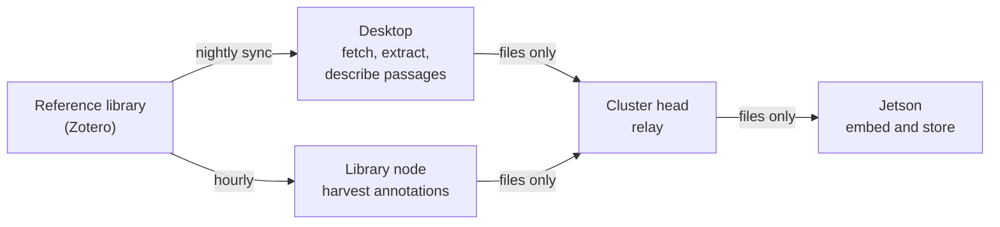
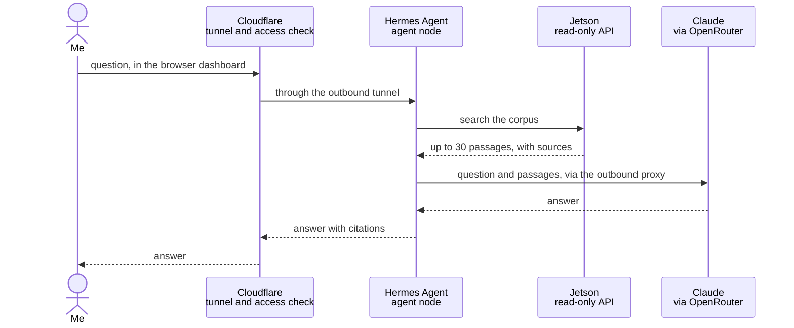

# How it works

*As of October 2026. The Mechanism keeps changing; this page describes its design, not every detail.*

The easiest way to understand The Mechanism is to follow two things through it: a book on its way
into the corpus, and a question on its way to an answer. Most of the design shows up along the
way, including where the boundaries sit and why.

## The machines

| Machine | Role |
|---|---|
| **Desktop** (GPU workstation) | The heavy lifting: fetching PDFs, extracting text, and running Qwen3 32B to describe each passage. Kept off the cluster network by design. |
| **Cluster head** (Raspberry Pi 5) | Coordination: scheduled workflows, monitoring, backups, the web front door, the relay that carries files between machines, and the proxy every outbound request must pass through. |
| **Agent node** (Raspberry Pi 5) | The research agent I talk to: [Hermes Agent](https://github.com/NousResearch/hermes-agent), an open-source agent framework from Nous Research. It runs on its own machine, as its own user, and holds no keys to the rest of the cluster. |
| **Jetson** (NVIDIA Orin Nano) | The corpus itself: the Chroma vector store, the nomic-embed-text embedding model, Qwen3 8B for triage, all served locally through Ollama, and a read-only API in front of them. |
| **Library node** (Raspberry Pi 4) | The only machine in the cluster holding the reference library's key. It harvests annotations and serves a narrow bridge for library writes. |
| **Other Raspberry Pi 4s** | A feed reader, a social media monitor, and three spares kept powered off. |

## A book's journey

1. **I file the book.** In the reference library I add a record with its PDF to the `vault`
   collection of a research track. A track is any top-level collection that has a `vault` child,
   so the library's own structure is the system's vocabulary. A new track needs no code change.
2. **The desktop fetches it.** Every night at 02:00 a sync on the desktop reads the library and
   fetches new PDFs into a local cache. If the library contradicts itself, for instance when an
   item has been trashed but its PDF hasn't, the sync refuses to publish that track's changes
   rather than guess. It reports the problem and leaves everything as it was.
3. **The text is extracted and checked.** Every six hours the desktop extracts the text. Scanned
   PDFs with no text layer, and texts too thin to be the whole work (a book yielding fewer than 40
   passages, for example), are set aside with a reason, not quietly ingested.
4. **Each passage is described.** The text is cut into overlapping passages of about 3,000
   characters. For each one, Qwen3 32B, running on the desktop's GPU, writes a one-sentence
   description of what the passage is about, which makes it much easier to find later. None of
   this leaves my hardware.
5. **Files travel, commands don't.** The results are written as plain files, and Syncthing
   carries them through the cluster head to the Jetson. The channel moves
   files only, so nothing on the desktop can instruct anything in the cluster.
6. **The Jetson stores it.** Within a minute the Jetson notices the new file, embeds each passage
   with nomic-embed-text, and stores it in that track's Chroma collection with its bibliographic
   details.
7. **Annotations follow separately.** Every hour the library node harvests my highlights and notes
   from the library and sends them the same way, into a collection of their own.

Removal is deliberately slower than addition. A work that is unfiled or deleted is removed only after
two observations agree and a grace period has passed, and the nightly cleanup is capped. A mistake
in the library can be undone before the corpus loses anything.

## A question's journey

1. **I ask.** Usually in the agent's browser dashboard. Cloudflare checks it's me with a one-time
   code, then passes the request down a tunnel the cluster itself opened, so nothing on the cluster
   listens for connections from the internet. I can also message the agent on Telegram, which it
   polls and which accepts messages only from my account.
2. **The agent searches.** It sends the question to the Jetson's API. That API is read-only and is
   the agent's only route to the corpus: it can't reach the store or the models behind it directly.
3. **The Jetson retrieves.** It embeds the question with the same model used for the passages,
   finds the nearest ones, and returns at most 30, each with its source.
4. **A frontier model synthesises.** The agent sends the question and those passages, never whole
   books, to Claude Opus 5.5 through OpenRouter. The request leaves through the cluster head's
   outbound proxy, which allows each machine only the destinations it needs.
5. **I get an answer with citations**, back where I asked.

## What the journeys show

- **Local where it matters.** Whole texts are fetched, extracted, described, embedded and stored on
  machines I own. A frontier model only ever sees the few passages a question retrieves.
- **One key, one machine.** Each credential lives on the one machine that needs it. The agent, the
  part most exposed to what it reads, holds the fewest.
- **Narrow channels.** Files move one way between the desktop and the cluster. The agent reaches the
  corpus through a read-only API, and every machine reaches the internet only through the proxy.
- **Refusing to guess.** When the inputs contradict each other, the system stops and says so instead
  of acting on a reading it can't trust. Removal waits for agreement. Both make it slower, and both
  have proved their worth.
