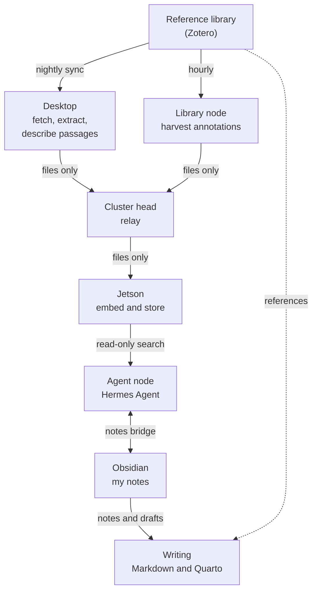
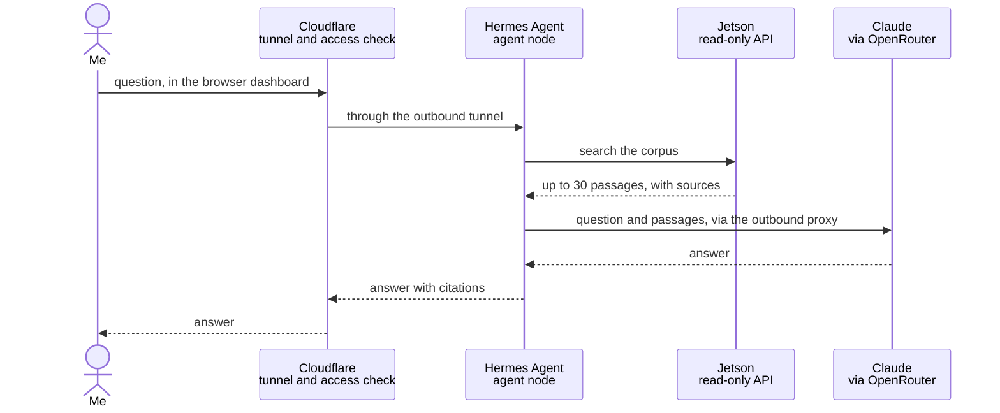

# How TM works

*As of October 2026. The Mechanism (TM) is evolving; this page provides an overview of some (but not all) of its functionality. The full code is kept in a private repository for security purposes.*

The easiest way to understand TM is to explore workflow examples. The two provided below are two of several I use on a regular basis.

## The machines

| Machine | Role |
|---|---|
| **Desktop** (GPU workstation) | The heavy lifting: fetching PDFs, extracting text, and running Qwen3 32B to describe each passage. Kept off the cluster network by design. |
| **Cluster head** (Raspberry Pi 5) | Coordination: scheduled workflows, monitoring, backups, the web front door, the relay that carries files between machines, and the proxy every outbound request must pass through. |
| **Agent node** (Raspberry Pi 5) | The research agent I talk to: [Hermes Agent](https://github.com/NousResearch/hermes-agent), an open-source agent framework from Nous Research. It runs on its own machine, as its own user, and holds no keys to the rest of the cluster. |
| **Jetson** (NVIDIA Orin Nano) | The corpus itself: the Chroma vector store, the nomic-embed-text embedding model, Qwen3 8B for triage, all served locally through Ollama, and a read-only API in front of them. |
| **Library node** (Raspberry Pi 4) | The only machine in the cluster holding the reference library's key. It harvests annotations and serves a narrow bridge for library writes. |
| **Other Raspberry Pi 4s** | A feed reader, a social media monitor, and three spares kept powered off. |

## An example workflow

1. **I file the book or article.** In the reference library I add a record with its PDF to the `vault`
   collection of a research track. A track is any top-level collection that has a `vault` child,
   so the library's own structure is the system's vocabulary. A new track needs no code change.
2. **The desktop fetches it.** Every night at 02:00 a sync on the desktop reads the library and
   fetches new PDFs into a local cache. If the library contradicts itself, for instance when an
   item has been trashed but its PDF hasn't, the sync refuses to publish that track's changes
   rather than guess. It reports the problem via Telegram and leaves everything as it was.
3. **The text is extracted and checked.** Every six hours the desktop extracts the text. Scanned
   PDFs with no text layer, and texts too thin to be the whole work (a book yielding fewer than 40
   passages, for example), are set aside with a reason, not quietly ingested.
4. **Each passage is described.** The text is cut into overlapping passages of about 3,000
   characters. For each one, Qwen3 32B, running on the desktop's GPU, writes a one-sentence
   description of what the passage is about, which makes it much easier to find later. None of
   this leaves my hardware.
5. **Files travel between machines, commands don't.** The results are written as plain files, and Syncthing
   carries them through the cluster head to the Jetson. The channel moves
   files only, so nothing on the desktop can instruct anything in the cluster.
6. **The Jetson stores it.** Within a minute the Jetson notices the new file, embeds each passage
   with nomic-embed-text, and stores it in that track's Chroma collection with its bibliographic
   details.
7. **Annotations follow separately.** Every hour the library node harvests my highlights and notes
   from the library and sends them the same way, into a collection of their own.
8. **The work continues in Obsidian.** My primary work with TM is collected in Obsidian notes: plain Markdown files holding lab notes, transcripts
   of discussion sessions, and drafts. The agent can reach them through a narrow bridge on the cluster
   head, allowing me to discuss my lab notes, results of previous workshops, and planning and concept development notes for the monograph with Hermes. I can also use Hermes to tidy up or rearrange my notes, or critique my progress and identify errors in my thinking. The Obsidian sync service keeps a copy of all of those notes on my computers, iPad and iPhone. 
9. **Writing.** I write in Markdown in a separate text editor (and old version of Sublime text), using Quarto (with Zotero) for referencing and footnoting, publishing to .docx or .pdf as required. This is a key step in the process, separating the act of writing from the collaborative human-AI research and concept development undertaken in TM.

## A question's workflow

1. **I ask.** Usually in the agent's browser dashboard. Cloudflare checks it's me with a one-time
   code, then passes the request down a tunnel the cluster itself opened, so nothing on the cluster
   listens for connections from the internet. I can also message the agent on Telegram, which it
   polls and which accepts messages only from my account. I use Telegram to interact with Hermes quite frequently when I'm on the go, asking it to write notes to Obsidian or add items to Zotero if necessary.
2. **The agent searches.** It sends the question to the Jetson's API. That API is read-only and is
   the agent's only route to the corpus: it can't reach the store or the models behind it directly.
3. **The Jetson retrieves.** It embeds the question with the same model used for the passages,
   finds the nearest ones, and returns at most 30, each with its source.
4. **A frontier model synthesises.** The agent sends the question and those passages, never whole
   books, to Claude Opus 5.5 through OpenRouter. The request leaves through the cluster head's
   outbound proxy, which allows the agent only the destinations it needs.
5. **I get an answer with citations** via either the Hermes dashboard or Telegram, depending where I asked.

## What the examples demonstrate

- **Local where it matters.** Whole texts are fetched, extracted, described, embedded and stored on
  machines I own. A frontier model only ever sees the few passages a question retrieves.
- **One key, one machine.** Each credential lives on the one machine that needs it. The agent, the
  part most exposed to what it reads, holds the minimum authority to do what it needs to.
- **Narrow channels.** Files move one way between the desktop and the cluster in a 'rivers of data' model. The agent reaches the
  corpus through a read-only API, and every machine reaches the internet only through the proxy.
- **Refusing to guess.** When inputs (i.e. scholarly sources) contradict each other, the system stops and alerts me to the discrepancy so I can resolve it myself.
- **Scientific transparency.** Zotero remains the canonical storage system for sources and annotations. Outputs from AI sessions are either ephemeral, or captured in lab notes or workshop summaries in Markdown if I ask for them.

## Engineering and deployment
I use VS Code for software engineering, with Claude Code and the [OpenSpec](https://openspec.dev/) framework. The code repository is kept private for security purposes. It contains detailed documentation of the network and security architecture, of necessity given the complexity of the system. 

## Maintenance

Most maintenance is performed in the same way as engineering and deployment, via SSH into the head node and subsequent SSH into nodes with deployment via Ansible, but I have UI access too, via four tools. n8n, Cockpit and Miniflux run on the cluster, behind the
same tunnel and one-time code as the agent's dashboard. The Zotero group library is a hosted service. 

### n8n

[n8n](https://n8n.io) is the workflow engine on the cluster head. It runs six workflows:

| Workflow | When | What it does |
|---|---|---|
| Weekly digest | Fridays | Takes the week's unread feed items, has Qwen3 8B score them, has Claude Sonnet 5 curate the relevant ones, publishes a digest page, and sends me a summary on Telegram. |
| Local backup | Daily | Backs the cluster up to local storage. |
| Cloud backup | Sundays | Sends an encrypted backup to cloud object storage. |
| Update check | Monthly | Compares the pinned versions of deployed services with the latest releases and reports on Telegram. Upgrades are done by hand. |
| Security reminder | Quarterly | Reminds me on Telegram to run the security review. It checks nothing itself. |
| Save paper | On request | Checks whether a paper is open access, writes a short summary if it is, files it in a track's queue in the library, and confirms on Telegram. |

Telegram delivers digest counts at each stage, so I know when new material is available to review. n8n stores the model and messaging keys and can make outbound requests from the cluster head, so a session there is powerful. It stays behind the one-time code.

### Cockpit
[Cockpit](https://cockpit-project.org) is a web console for Linux servers, installed on every machine
in the cluster. It shows each machine's services, logs, and storage in a browser and includes a
terminal. Its console provides a UI into each machine, including terminal access. 

Cockpit provides root-level administration, so it is treated the same as n8n. Only the cluster head's
console is reachable through the tunnel. The others accept connections from the cluster head alone.

### Miniflux

[Miniflux](https://miniflux.app) is the feed reader, installed on its own Raspberry Pi 4 with about 90 feeds
sorted into 13 categories. Each category maps to a research track, which tells the weekly digest what
to judge an item against. Two small helpers sit beside it for sources that don't offer a usable feed:
RSSHub, and a proxy for Springer's feeds.

Maintenance here is mostly editorial: adding and removing feeds, and keeping the categories in line
with the tracks. The agent can add and remove feeds too, through its bridge, without seeing the key. This allows me to add feeds to TM using Telegram while I'm on the go.

Miniflux entries are marked read only once a run has dealt with them. If a backlog builds
up, I mark feeds as read in Miniflux rather than relying on pipeline automation.

### The Zotero group library

The TM corpus is defined by a [Zotero](https://www.zotero.org) group library called The Mechanism, not by
my personal library. My personal library holds about 11,000 items gathered over twenty years and
I don't want AI agents to have write access to it. The group library is working material that can be lost if an agent makes a mistake. The agent's bridge is bound
to the group library alone, using its own dedicated API key, and the library is private.

The two main tracks in Zotero each have a queue, where saved papers and selections from the RSS digest are placed for manual processing (i.e. for when I have the time to review and/or read and annotate them). Nothing enters the corpus until it is filed into a track's `vault` collection, so the system relies on me manually filing sources: nothing enters TM without my manual intervention. The other collections are there for my own organisation; the system ignores them except when it is harvesting annotations.

